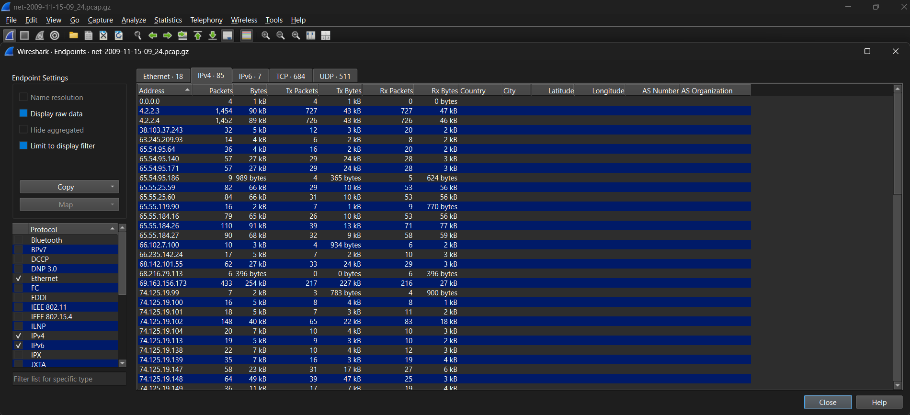
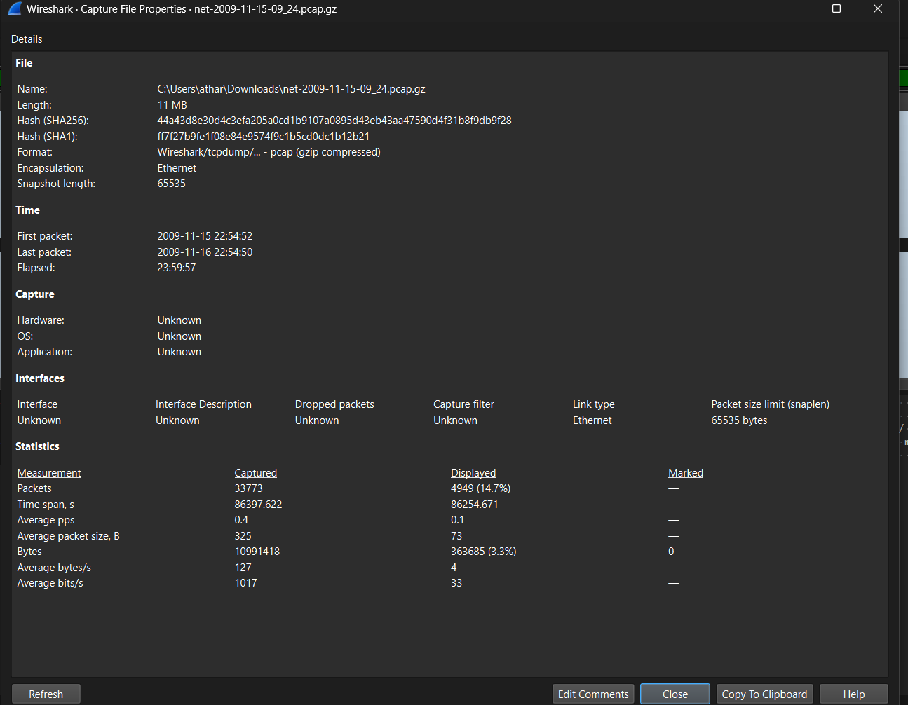
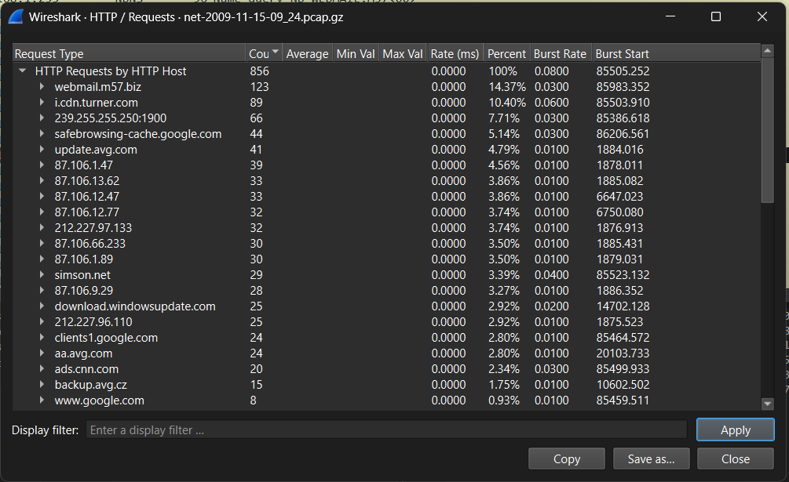
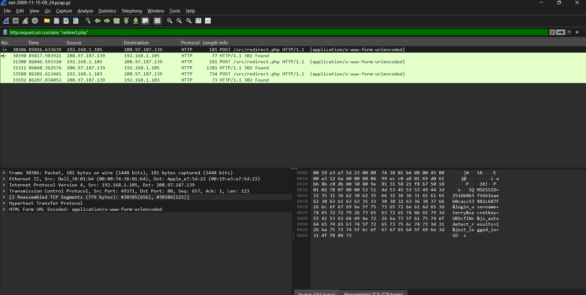
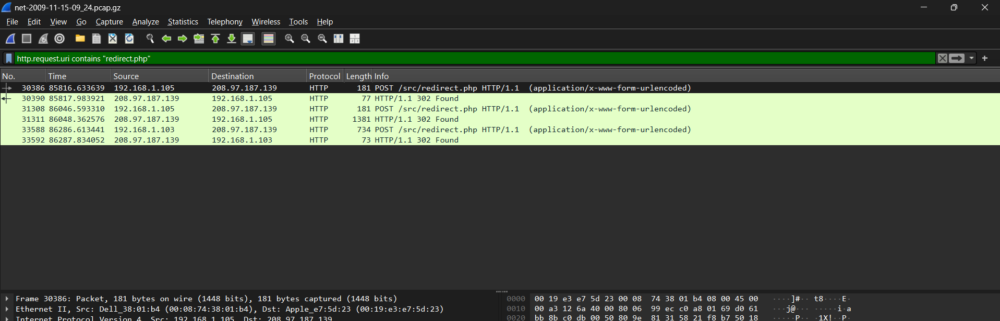

# Artefact Analysis — Network / PCAP (Evidence File 3)

## 1. Evidence Information

| Field | Details |
|---|---|
| Evidence Category | Network |
| Evidence File | `net-2009-11-15-09_24.dmp` |
| Analyst | Atharv Nair (PRN 25030241081) |
| Hash Algorithm | SHA-256 |
| Hash | `f35e39a7d8533c07341ce490b9db00a93b5815e9defae87919d85425c9173a92` |
| File Size | 11,531,810 bytes (about 11.0 MiB) |
| Format | libpcap 2.4, Ethernet, microsecond timestamps, snap length 65535 |
| Tool(s) Used | Wireshark (Endpoints, Conversations, HTTP Requests, Follow TCP Stream, display filters); Python/dpkt script for independent cross-checking of counts |

**Relationship to the other network evidence files:** this is the third PCAP for the Network category, captured the day immediately after `net-2009-11-14-09_24.dmp` (analysed separately) and about 10 days before `net-2009-11-25-16_54.dmp`. All three share the same LAN, the same four workstation hostnames, and the same unidentified host `192.168.1.50`.

---

## 2. Objective

To analyse this third network capture in Wireshark and:

1. identify the **Top 5 IP addresses by packet count**;
2. identify the hosts, including any new activity not seen in the other two evidence files;
3. investigate a set of company-webmail logins carried in cleartext; and
4. correlate machine identifiers, the unidentified host, and NetBIOS behaviour with the other two evidence files.

---

## 3. Investigation Performed

### 3.1 Capture overview and integrity

**Tool / Technique:** SHA-256 hashing; Statistics → Capture File Properties.

**Observation:**

| Property | Value |
|---|---|
| Packets | 33,773 |
| First packet | 2009-11-15 17:24:52 UTC = **2009-11-15 09:24:52 PST** |
| Last packet | 2009-11-16 17:24:50 UTC = **2009-11-16 09:24:50 PST** |
| Duration | 86,397.6 s (about 24 hours) |
| Frame types | IPv4 29,710 (88.0%) · LLDP 2,869 (8.5%) · ARP 971 (2.9%) · IPv6 223 |
| IPv4 transport | UDP 16,025 packets · TCP 13,685 packets |

The file name (`09_24`) again matches the first-packet time converted to PST (Assumption A1, carried over from the other evidence files).

*Figure 1 — Statistics → Capture File Properties: SHA-256 hash and 33,773 packets. [S10]*

**Interpretation:** A third full 24-hour capture of the same LAN. This one has more TCP traffic and more distinct external IP addresses (85 IPv4 endpoints, versus 42 and 46 in the other two files), consistent with a workstation being used for active web browsing during this window (Section 3.4).

**Finding:** Same LAN, same core hosts, but noticeably more diverse traffic than the other two evidence files — driven mainly by one workstation (`192.168.1.105`, Terry) actively browsing the web.

---

### 3.2 Top 5 IP addresses (Statistics → Endpoints → IPv4)

**Observation:**

| Rank | IP address | Packets | MAC | Hostname / role |
|---|---|---|---|---|
| 1 | `192.168.1.50` | 10,892 | `00:0f:66:ae:e9:8a` | Unidentified (same as the other two evidence files) |
| 2 | `192.168.1.1` | 10,301 | `00:19:e3:e7:5d:23` | Gateway, DHCP/DNS server |
| 3 | `192.168.1.105` | 8,866 | `00:08:74:38:01:b4` | M57-Terry |
| 4 | `224.0.0.1` | 2,880 | — | All-hosts multicast (not a host) |
| 5 | `192.168.1.103` | 2,740 | `00:0b:db:63:5b:d4` | m57-pat |

Sixth and seventh: `192.168.1.104` (2,267, m57-charlie) and `192.168.1.102` (1,980, m57-jo).

*Figure 2 — Statistics → Endpoints → IPv4 sorted by Packets. [S1]*

**Interpretation:** The unidentified host `.50` again tops the list, consistent across all three evidence files. What's new here is that **Terry's machine outranks the gateway's usual workstation traffic** by a wide margin — 8,866 packets versus 2,000–3,000 for the other three workstations — which is explained entirely by active web browsing (Section 3.4), not by anything suspicious in itself.

**Finding:** Top 5: `192.168.1.50` (unidentified), the gateway, M57-Terry, a multicast address, and m57-pat.

---

### 3.3 Host identification

**Observation:**

| IP | MAC | Hostname (DHCP) | Role this capture |
|---|---|---|---|
| 192.168.1.102 | `00:0b:db:63:58:a6` | m57-jo | Background traffic only (AV, updates) |
| 192.168.1.103 | `00:0b:db:63:5b:d4` | m57-pat | Background traffic, **plus one webmail login near the end** |
| 192.168.1.104 | `00:0b:db:4f:6b:10` | m57-charlie | Background traffic only |
| 192.168.1.105 | `00:08:74:38:01:b4` | **M57-Terry** | Active web browsing, webmail (twice), CNN, general browsing |
| **192.168.1.50** | `00:0f:66:ae:e9:8a` | not present | Unidentified — same signature as evidence files 1–2 |

*Figure 3 — `dhcp` filter: all four workstations, including M57-Terry. [S3]*

**Note:** the DHCP hostname is recorded here as `M57-Terry` (mixed case), while the earlier evidence file recorded `M57-TERRY` (all caps). Both resolve to the same MAC address, so this is the same machine — the case difference is likely just how the hostname was typed into Windows at different times, not two different hosts.

**Interpretation:** All four workstation identities are confirmed and consistent with the other evidence files. `192.168.1.50` shows the identical fixed-port DNS/NTP-style traffic pattern and TTL 150 seen in both other captures — see Appendix A2.6.

**Finding:** No new hosts. `192.168.1.50` remains unidentified across all three evidence files, which is itself notable — a genuine workstation would be expected to show some variation across three different capture days, while this host behaves identically each time.

---

### 3.4 ⚠ Cleartext webmail credentials

**Tool / Technique:** `http.request.uri contains "redirect.php"`, Follow TCP Stream.

**Observation:** Near the end of the capture (the last ~10 minutes), two workstations log in to `webmail.m57.biz` (`208.97.187.139`) over plain HTTP:

| Time (PST) | Host | Username | Password |
|---|---|---|---|
| 2009-11-16 09:15:09 | 192.168.1.105 (Terry) | `terry` | `UBScfINr` |
| 2009-11-16 09:18:59 | 192.168.1.105 (Terry) | `terry` | `UBScfINr` |
| 2009-11-16 09:22:59 | 192.168.1.103 (Pat) | `pat` | `Hw*JJbJL` |

Full detail, including session IDs and frame numbers, is in Appendix A2.2.

*Figure 4 — `http.request.uri contains "redirect.php"`, frame 30386: `login_username=terry&secretkey=UBScfINr` visible in cleartext. [S5]*

**Interpretation:** The webmail application (SquirrelMail) does not enforce HTTPS for its login form, so the username and password travel across the network unencrypted. Anyone able to observe this traffic — which, in a forensic sense, is exactly what has happened here — can read the credentials directly from the packet capture.

**Finding:** This is a genuine, verifiable security weakness (no transport encryption on a login form), independent of whether anyone actually misused the traffic. It is also directly useful for the Email evidence category: **these credentials may let the email analyst access the corresponding mailboxes**, if that evidence includes the same webmail or mail server.

Terry logs in twice about 3.5 minutes apart, then reads mail across several folders and opens the compose window a few times; Pat logs in once, right at the very end of the capture window, and only reaches the inbox before the capture ends.

---

### 3.5 Browser keystrokes reconstructed from NetBIOS traffic

**Tool / Technique:** `nbns && ip.src == 192.168.1.105`.

**Observation:** Terry's machine broadcasts a sequence of NetBIOS name queries that build up two hostnames one character at a time: `WE → WEB → WEBM → WEBMA → WEBMAI → WEBMAIL.M57`, and separately `WWW.C.COM → WWW.S.COM → WWW.SIMSON..COM → WWW.SIMSON.NETM` (converging on `www.simson.net`).

*Figure 5 — `nbns && ip.src == 192.168.1.105`, sorted by time. [S6]*

**Interpretation:** This is a byproduct of the browser's address-bar autocomplete feature, which some Windows configurations resolve partly via NetBIOS. Each partial string corresponds to what had been typed at that moment.

**Finding:** Independent, packet-level confirmation that a user at `192.168.1.105` typed `webmail.m57.biz` and `www.simson.net` into a browser — matching and corroborating the HTTP evidence in Section 3.4 and Appendix A2.4.

---

### 3.6 Recurring artefacts (consistent with evidence file 2)

**Observation:**

- `192.168.1.102` (Jo) and `192.168.1.103` (Pat) again broadcast 120 unanswered NBNS queries each for `M57-CHARLIE<0x20>` — identical to the pattern in evidence file 2.
- The `explabs.net` telemetry report from `192.168.1.104` again carries `UID=251793970` / `M=ff12903c…`, matching evidence files 1 and 2 exactly (see Appendix A2.5 for all four hosts' identifiers in this capture).
- `wpad.m57.biz` and `isatap.m57.biz` again return NXDOMAIN, plus a new NXDOMAIN this time: `_ldap._tcp.dc._msdcs.m57.biz` — a failed Active Directory domain-controller lookup, consistent with a workgroup (not domain-joined) network.

**Finding:** These recurring artefacts, seen identically across two or three separate capture days, strengthen (without proving) the interpretations already offered in the other evidence files: an unresolved share-connection attempt from Jo/Pat to Charlie's machine, a consistent machine identity for Charlie across captures, and a network with no Active Directory domain controller.

---

## 4. Important Artefacts

| Artefact | Location / Identifier | Observation | Interpretation | Significance |
|---|---|---|---|---|
| Cleartext webmail credentials | Figure 4, Appendix A2.2 | `terry`/`UBScfINr`, `pat`/`Hw*JJbJL` sent over HTTP | Login form has no transport encryption | **Very high** — directly usable finding, cross-relevant to the Email category |
| NBNS keystroke reconstruction | Figure 5, Appendix A2.3 | Incremental partial-hostname queries from Terry | Confirms address-bar typing of two specific URLs | High — corroborates the HTTP finding independently |
| Top 5 endpoints | Figure 2 | `.50`, `.1`, `.105`, `224.0.0.1`, `.103` | Unidentified host again ranks 1st; Terry ranks high due to browsing | High — required output |
| Host `.50` consistency | Appendix A2.6 | Identical TTL 150 and traffic pattern across 3 captures | Strengthens the appliance/monitoring hypothesis | High — cumulative evidence |
| `explabs.net` UID match | Appendix A2.5 | Charlie's `UID=251793970` matches all three evidence files | Confirms same physical machine across all three captures | High — verified correlation |
| `M57-CHARLIE` NBNS queries | Appendix A2.7 | Repeated by Jo and Pat, as in evidence file 2 | Recurring attempted share connection | Medium — disk/memory correlation candidate |
| AD domain-controller NXDOMAIN | Appendix A2.8 | `_ldap._tcp.dc._msdcs.m57.biz` fails | No Active Directory domain controller on this network | Low — network configuration context |

---

## 5. Evidence Supporting the Finding

- **The credential capture is not inferred — it is the literal packet content.** The username and password appear as plaintext form fields in the HTTP request body; no decoding or guessing was involved.
- **The keystroke reconstruction is independently corroborated** by two separate protocols: the HTTP requests themselves (Section 3.4) and the NetBIOS name queries (Section 3.5) tell the same story from two different layers of the capture.
- **Host `.50`'s signature (fixed source port, TTL 150, DNS/NTP-only traffic) is byte-for-byte consistent** across three captures recorded on three different days, which is strong (though not conclusive) evidence that it is a fixed appliance rather than a general-purpose PC whose behaviour would be expected to vary.

---

## 6. Correlation With Other Evidence

| Evidence Source | Related Artefact (what to check) | Relationship |
|---|---|---|
| Email | `webmail.m57.biz` / `mailboxes.m57.biz`, credentials `terry`/`UBScfINr` and `pat`/`Hw*JJbJL` | **Directly actionable** — these credentials may open the corresponding mailboxes in the Email evidence |
| Network (evidence files 1–2) | `explabs.net` `UID=251793970` for host .104 | **Supported** — identical across all three captures |
| Network (evidence file 2) | `M57-CHARLIE` NBNS queries from Jo/Pat | **Supported** — identical pattern recurs |
| Disk (.105, .103) | Browser history for `webmail.m57.biz` and `www.simson.net`; saved SquirrelMail session or cached credentials | To be confirmed by the disk analyst |
| Disk / Memory (any host) | A device matching MAC `00:0f:66:ae:e9:8a` or IP `192.168.1.50` | To be confirmed — would help identify the unknown host |

---

## 7. Limitations

- **Host `192.168.1.50` still cannot be identified** from network evidence alone, despite three consistent observations. A definitive identification requires disk or physical inspection.
- The credentials found here are only as useful as the corresponding Email evidence — if the group's email evidence file is unrelated to `webmail.m57.biz`, this correlation cannot be completed.
- Only two logins are captured in this 24-hour window; there is no way to know from this evidence alone whether these credentials are still valid or have since been changed.
- General web-browsing content (page bodies, search terms, etc.) beyond what is shown in Sections 3.4–3.5 was not exhaustively reviewed; a full content review is out of scope for this summary-level analysis.

**Assumptions**

| ID | Assumption | Basis |
|---|---|---|
| A1 | Capture clock is local Pacific time (UTC−8) | File name matches the first-packet time in PST (carried over from the other evidence files) |
| A2 | `192.168.1.50` is a non-Windows appliance or monitoring device | Same unconfirmed hypothesis as evidence file 2, now reinforced by a third identical observation |

---

## 8. Conclusion

This third capture covers the same LAN as the other two network evidence files. The Top 5 IPs by packet count are `192.168.1.50` (still unidentified), `192.168.1.1`, `192.168.1.105` (Terry), `224.0.0.1` and `192.168.1.103` (Pat). The most significant finding is a pair of **cleartext webmail logins** — `terry`/`UBScfINr` and `pat`/`Hw*JJbJL` — sent over unencrypted HTTP to `webmail.m57.biz`, independently corroborated by a NetBIOS-based reconstruction of the same browsing activity. This is a genuine security finding and a directly useful lead for the Email evidence category.

Beyond that, the picture is consistent with the other two evidence files: ordinary security-software and update traffic, a recurring unidentified host (`192.168.1.50`), and a recurring, unresolved attempt by Jo's and Pat's machines to reach a share on Charlie's machine.

> **Important:** Do not state a conclusion that is not supported by the available evidence. The credential values should be re-verified in Wireshark before they are relied on elsewhere in the report, and the identity of `192.168.1.50` remains unresolved.
