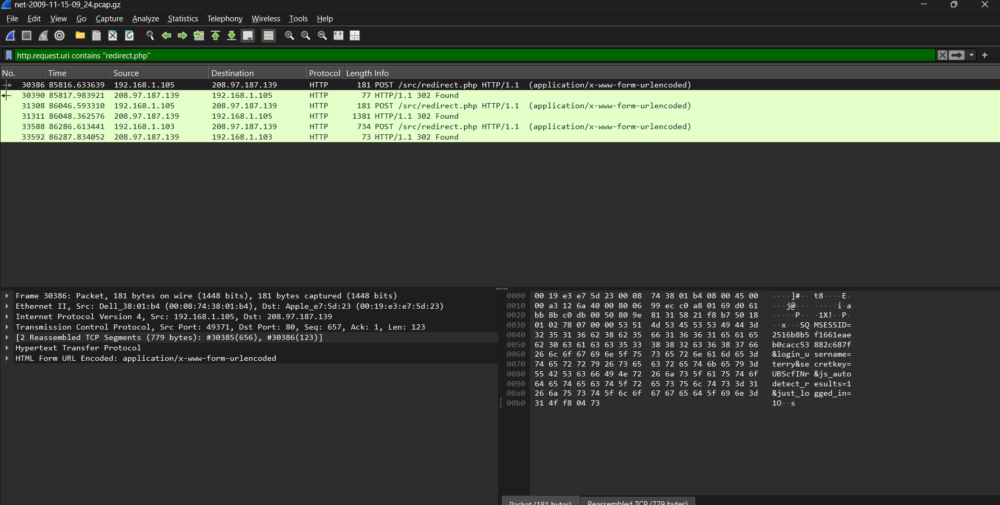
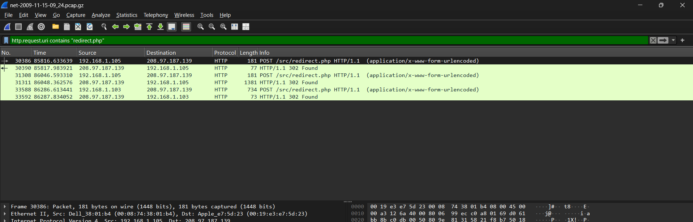

# Appendix A2 — DNS, HTTP, Webmail Credentials and NBNS Detail (Evidence File 3)

**Evidence file:** `net-2009-11-15-09_24.dmp`  
**Timestamps:** shown in PST (UTC−8).

---

## A2.1 DHCP hostnames (filter: `dhcp`)

| IP | MAC | Hostname (Option 12) |
|---|---|---|
| 192.168.1.102 | `00:0b:db:63:58:a6` | m57-jo |
| 192.168.1.103 | `00:0b:db:63:5b:d4` | m57-pat |
| 192.168.1.104 | `00:0b:db:4f:6b:10` | m57-charlie |
| 192.168.1.105 | `00:08:74:38:01:b4` | **M57-Terry** (note the mixed case — earlier evidence files show `M57-TERRY` in all caps; both are the same host by MAC) |

`192.168.1.50` again sends **no** DHCP traffic. [S3]

---

## A2.2 ⚠ Cleartext webmail credentials (the key finding in this capture)

**Filter:** `http.request.uri contains "redirect.php"` or `http contains "login_username"`.

Near the end of the capture, two workstations log in to the company webmail (SquirrelMail) over **plain HTTP** — not HTTPS — so the login form submits the username and password in cleartext:

| Frame | Time (PST) | Host | Username | Password ("secretkey") | Session ID (SQMSESSID) |
|---|---|---|---|---|---|
| 30386 | 2009-11-16 09:15:09 | 192.168.1.105 (Terry) | `terry` | `UBScfINr` | `2516b8b5f1661eaeb0cacc53882c687f` |
| 31308 | 2009-11-16 09:18:59 | 192.168.1.105 (Terry) | `terry` | `UBScfINr` | `368579fb7bf960c067bbfedb1f774dcf` |
| 33588 | 2009-11-16 09:22:59 | 192.168.1.103 (Pat) | `pat` | `Hw*JJbJL` | `16823db712441f8174779d2eadcd1619` |

Both logins go to `webmail.m57.biz` (`208.97.187.139`), a SquirrelMail webmail interface. Terry logs in twice in quick succession (about 3.5 minutes apart, likely a page reload or a repeated navigation), then browses the inbox, drafts, sent items and trash folders and opens the compose window several times. Pat logs in once near the very end of the capture and only reaches the inbox view before the capture ends.

*Figure — Follow TCP Stream (or the raw hex pane) of frame 30386, showing `login_username=terry&secretkey=UBScfINr` in cleartext. [S5]*

**Finding:** The company webmail server accepts logins over unencrypted HTTP, so **any credentials sent to it during this capture window are exposed in the packet capture itself**. This is a legitimate security finding in its own right (a protocol weakness), independent of whether the credentials were used maliciously. It is also directly useful to the Email evidence category — the disk/email analysts can use these two username/password pairs to open the corresponding mailboxes if the email evidence includes access to `webmail.m57.biz` or `mailboxes.m57.biz`.

**Handle this evidence carefully in your write-up:** state that the credentials were captured in cleartext and explain the significance (no transport encryption), rather than only listing the values. If your ma'am or group prefers not to print the literal password strings in the shared report, keep them here in the appendix and reference "see Appendix A2.2" from the main analysis instead.

---

## A2.3 Browser address-bar keystrokes reconstructed from NetBIOS lookups

**Filter:** `nbns && ip.src == 192.168.1.105`.

Windows resolves anything that isn't a valid domain name (or that fails DNS) via NetBIOS as a fallback. When a user types a URL into the browser's address bar, some versions of Internet Explorer fire a NetBIOS name query after **each keystroke** while auto-completion is active. In this capture, Terry's machine generates a sequence of broadcast NBNS queries that spell out two URLs one character at a time:

| Sequence | Decoded partial name |
|---|---|
| 1 | `WE` → `WEB` → `WEBM` → `WEBMA` → `WEBMAI` → `WEBMAIL.M57` |
| 2 | `WWW.C.COM` → `WWW.S.COM` → `WWW.SIMSON..COM` → `WWW.SIMSON.NETM` (converging on `www.simson.net`) |

*Figure — `nbns && ip.src == 192.168.1.105`, sorted by time: the incremental single-label queries. [S6]*

**Finding:** This independently confirms — from Layer 2/3 traffic alone, without reading any HTTP request — that a user at the keyboard of `192.168.1.105` (Terry) typed `webmail.m57.biz` and `www.simson.net` into a browser address bar. This corroborates the HTTP evidence in A2.2 and A2.4 and is a good example of deriving a **Finding** from **Interpretation** of an **Observation**, as the guideline asks: the observation is the sequence of broadcast packets, the interpretation is that they represent address-bar keystrokes, and the finding is that a named machine's user typed these specific addresses.

---

## A2.4 Other HTTP activity from Terry's machine

**Filter:** `ip.src == 192.168.1.105 && http`.

| Host | Requests | What it is |
|---|---|---|
| `i.cdn.turner.com` / `i2.cdn.turner.com` | 93 | CNN image CDN — consistent with browsing a CNN photo gallery or slideshow |
| `safebrowsing-cache.google.com` | 44 (shared with .103) | Browser's background Google Safe Browsing list update — automatic, not a deliberate visit |
| `www.cnn.com`, `ads.cnn.com`, `www.simson.net` | several | General web browsing |
| `clients1.google.com` | 24 | Background Chrome/Firefox service traffic |

DNS answers (Appendix A1 is not exhaustive) additionally show lookups for `en.wikipedia.org`, `forensicwiki.org`, `www.afflib.org`, `bugs.python.org`, `docs.python.org`, `www.mozilla.org`, `www.linkedin.com`, `twitter.com` and `www.gnupg.org` — ordinary general-purpose web browsing.

**Note on `simson.net` / `forensicwiki.org` / `afflib.org`:** these domains belong to Simson Garfinkel, a digital-forensics researcher. Their presence here is worth mentioning factually; do not speculate about why they were visited beyond what the evidence shows (a browsing history entry, nothing more).

---

## A2.5 Mailshell, AVG, explabs and update traffic (consistent with the other evidence files)

Same pattern as evidence files 1 and 2: `POST /rpc.html?e=bl` to the ten Mailshell-resolved servers (this time from all four workstations, ~230 requests total); AVG update/statistics traffic; Windows Update; and one `POST /or/d.aspx` telemetry report per workstation to `mmi.explabs.net`.

**Telemetry machine identifiers (per-host `UID`/`M` values):**

| Host | UID | M (machine hash) |
|---|---|---|
| 192.168.1.104 (Charlie) | `251793970` | `ff12903ccc2e1ee3d36606233877b655` |
| 192.168.1.103 (Pat) | `251890307` | `420e5cf04aa1aebb02df80f83d43325e` |
| 192.168.1.105 (Terry) | `251128314` | `69314d57ab1e71b926ecaf1e5727268c` |
| 192.168.1.102 (Jo) | `251211253` | `1d889accbbccfdddaf3f3cf1f2c2239a` |

**Cross-capture correlation (verified):** Charlie's `UID=251793970` and `M=ff12903c…` are **identical** across all three network evidence files collected so far, confirming the same physical machine each time.

---

## A2.6 Host `192.168.1.50` — consistent with evidence files 1 and 2

Same signature as before: fixed source port 65432, cyclic DNS-style queries to the gateway and `4.2.2.3`/`4.2.2.4`, real queries for `time.nist.gov`/`time.windows.com`/`ncnoc.ncren.net`, no DHCP/HTTP/NetBIOS, and a constant **IP TTL of 150**. This is now observed identically in **three separate 24-hour captures**, which strengthens (but does not prove) the appliance/monitoring-device hypothesis — a genuine workstation would be expected to show at least some variation (browsing, updates, reboots) across three different days.

---

## A2.7 NetBIOS `M57-CHARLIE` lookups (recurring across evidence files 2 and 3)

`192.168.1.102` (Jo) and `192.168.1.103` (Pat) again broadcast 120 unanswered NBNS queries each for `M57-CHARLIE<0x20>` — the same pattern seen in evidence file 2. This repetition across two separate capture days strengthens the case for checking Jo's and Pat's disk images for a scheduled task or mapped drive that targets Charlie's machine.

---

## A2.8 DNS anomalies

`dns.flags.rcode == 3` (NXDOMAIN) shows the familiar `wpad.m57.biz` and `isatap.m57.biz`, plus a new one: `_ldap._tcp.dc._msdcs.m57.biz` (×4) — a Windows client trying to locate an Active Directory domain controller for `m57.biz` and failing. This is consistent with a workgroup-based network with no domain controller, not with malicious activity.

---

## A2.9 Screenshot placeholders

- [Insert screenshot: `dhcp` filter — S3]
- [Insert screenshot: `http.request.uri contains "redirect.php"`, Follow TCP Stream on frame 30386 (Terry) — S5]
- [Insert screenshot: `nbns && ip.src == 192.168.1.105`, sorted by time — S6]
- [Insert screenshot: `ip.addr == 192.168.1.50 && udp.port == 53` — S4]
- [Insert screenshot: Statistics → HTTP → Requests — S8]
- [Insert screenshot: `dns.flags.response == 0` — S9]
